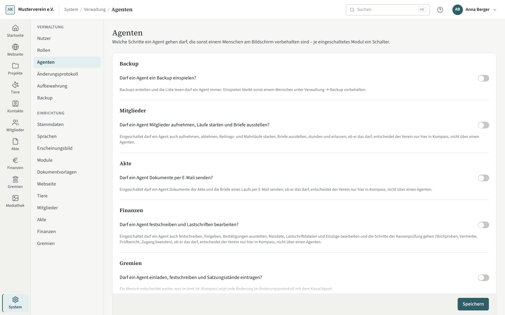

# Agenten

Ein Agent arbeitet über MCP mit denselben Rechten wie die Person, deren Schlüssel er nutzt. Einige Schritte bleiben
trotzdem einem Menschen am Bildschirm vorbehalten — festschreiben, einladen, senden, ein Backup einspielen. Unter
**Verwaltung → Agenten** legen Sie an einer Stelle fest, ob ein Agent sie doch gehen darf.

## Ein Schalter je Modul

Für jedes eingeschaltete Modul, das solche Schritte kennt, steht hier ein Abschnitt mit dem Namen des Moduls und
einer Frage „Darf ein Agent …?“. Der Hinweis darunter sagt, was der Schalter freigibt. Ein ausgeschaltetes Modul
erscheint nicht; schalten Sie es unter [Module](module.md) ein, steht sein Schalter wieder da, so wie er war.

| Abschnitt | Frage |
|---|---|
| Backup | Darf ein Agent ein Backup einspielen? |
| Mitglieder | Darf ein Agent Mitglieder aufnehmen, Läufe starten und Briefe ausstellen? |
| Akte | Darf ein Agent Dokumente per E-Mail senden? |
| Finanzen | Darf ein Agent festschreiben und Lastschriften bearbeiten? |
| Gremien | Darf ein Agent einladen, festschreiben und Satzungsstände eintragen? |

Voreingestellt sind alle Schalter aus: Ein Agent bereitet vor, ein Mensch entscheidet. Was ohne Schalter für einen
Agenten geht und was nicht, steht auf den Seiten der Module.

## Speichern

Die Schalter gelten erst mit „Speichern“ in der Leiste unter der Karte; „Verwerfen“ stellt den gespeicherten Stand
wieder her. Jede Änderung steht im [Änderungsprotokoll](aenderungsprotokoll.md). Ändern darf, wer die
Vereinseinstellungen verwalten darf — und nur hier in der Oberfläche: Über einen Agenten lässt sich kein Schalter
umlegen, auch nicht mit allen Rechten.
