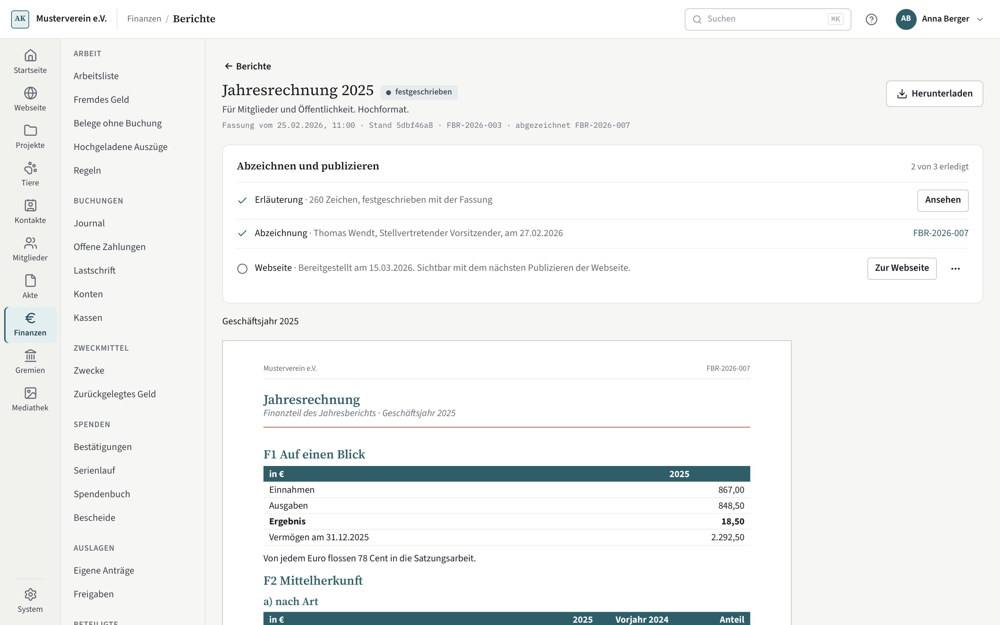

# Berichte

Kompass rechnet aus den Buchungen die Berichte, die ein Verein der
Mitgliederversammlung, den Kassenprüfern und dem Finanzamt vorlegt. Jeder
Bericht trägt eine Ausgabestufe; was vorgelegt wird, ist festgeschrieben und
ändert sich nicht mehr.

## Die vier Kernberichte

- **Einnahmen-Überschuss-Rechnung** (quer): Einnahmen und Ausgaben je
  Kategorie, getrennt nach Bereich — ideeller Bereich, Vermögensverwaltung,
  Zweckbetrieb, wirtschaftlicher Geschäftsbetrieb —, mit dem Vorjahr daneben.
  Im ersten Geschäftsjahr fehlt die Spalte „Vorjahr“, statt Nullen zu zeigen.
  Durchlaufende Gelder stehen getrennt und gehen in kein Ergebnis ein. Schließt
  der wirtschaftliche Geschäftsbetrieb oder die Vermögensverwaltung mit einem
  Verlust, steht ein Hinweis darunter: Der Verlust ist binnen zwölf Monaten
  nach Ende des Jahres auszugleichen (Anlaufverluste: drei Jahre). Ein Verlust
  im Zweckbetrieb ist kein Fehler und bekommt keinen Hinweis. Ab 2026 lassen
  sich Zweckbetrieb und wirtschaftlicher Geschäftsbetrieb zusammengefasst
  darstellen, wenn ihre Einnahmen zusammen die Grenze des § 64 Abs. 3 AO nicht
  übersteigen und sie zusammen einen Gewinn haben — nur in der Darstellung.
- **Vermögensübersicht** (hoch): zum Ende des Geschäftsjahres die Geldkonten,
  die offenen Zahlungen an den Verein und des Vereins, das Reinvermögen und
  davon zweckgebunden, in Rücklagen und frei. Darunter, nachrichtlich, das
  sonstige Vermögen (siehe unten).
- **Kassenbericht** (quer, zwei Seiten): der Kassenteil des Jahresberichts.
  Seite 1 zeigt die Bestände am Anfang je Konto, das Ergebnis, die Veränderung
  der durchlaufenden Gelder, die Bestände am Ende und die **Probe** — dazu
  rechts Einnahmen und Ausgaben je Kategorie mit einer Spalte je Bereich, Summe
  und Vorjahr. Hat der Verein mehr Kategorien, als auf die Seite passen
  (etwa 22), fasst Kompass je Bereich die kleinsten zu „Übrige“ zusammen; einzeln
  stehen sie in der Einnahmen-Überschuss-Rechnung. Seite 2 zeigt Zweckbindungen
  und Rücklagen (Vortrag, Zugang, Verwendet, Ende), offene Zahlungen, sonstiges
  Vermögen, Zahlungen an Organmitglieder je Funktion ohne Namen und — nur wenn es
  welche gibt — Korrekturen an Vorjahren.
- **Kontenabstimmung** (hoch): je Konto der festgeschriebene Buchbestand zum
  Stichtag gegen den Kontoauszug, das Zählprotokoll der Kasse oder einen
  eingegebenen Kontostand. Weicht ein Konto ab, steht daneben der Bestand
  einschließlich geprüfter Entwürfe — oft erklärt er die Abweichung. Ein
  Zahlungsdienst ohne Auszug und ohne Kontostand ist „nicht abstimmbar“.

## Jahresrechnung

Die **Jahresrechnung** (hoch, Gruppe „Öffentlichkeit“) ist der Finanzteil des
Jahresberichts für Mitglieder, Spender und Öffentlichkeit. Sie deckt die Punkte
7, 8 und 10 der Initiative Transparente Zivilgesellschaft ab: Mittelherkunft,
Mittelverwendung mit Vermögen und die großen Zuwender. Der Bericht heißt wie
Schritt 11 des Jahresabschlusses („Jahresrechnung genehmigt“); dort ist die
Genehmigung durch die Mitgliederversammlung nach der Satzung gemeint, die sich
auf Kassenbericht und Jahresrechnung stützt.

Die Abschnitte haben feste Nummern, damit eine Webseite auf „F3“ verweisen kann:

- **F1 Auf einen Blick:** Einnahmen, Ausgaben, Ergebnis, Vermögen am Jahresende
  und „Von jedem Euro flossen … Cent in die Satzungsarbeit“.
- **F2 Mittelherkunft:** nach Art (Geldspenden, Sachspenden, Nachlässe,
  Mitgliedsbeiträge, Zuwendungen der öffentlichen Hand und anderer
  Organisationen, Geldauflagen — nur wenn es welche gibt —, Umsatzerlöse,
  Vermögensverwaltung, Sonstiges) und nach Bereichen. Die Zeile folgt der
  Einnahmenart der Kategorie. Auszahlungen einer Spendenplattform stehen unter
  den Geldspenden mit der Unterzeile „davon über Spendenplattformen“; dafür trägt
  die Kategorie das Merkmal **Spendenplattform** („bestätigt selbst“ bei einer
  Zuwendung einer Körperschaft, „wickelt nur ab“ bei einer Spende). Ein
  Aufwandsverzicht zählt nur als Geldspende, wenn der Antrag mit allen
  Prüfungen freigegeben ist.
- **F3 Mittelverwendung:** Programm (Satzungsarbeit) je veröffentlichtem
  Projekt, der Rest als „übrige Satzungsarbeit“, darin nachrichtlich die
  Weiterleitung an Partnerorganisationen (§ 58 Nr. 1 AO) und Zahlungen an
  Hilfspersonen (§ 57 Abs. 1 S. 2 AO); dann Werbung und Verwaltung nach der
  Kostenart der Kategorie, getrennt darunter die Ausgaben der
  Vermögensverwaltung und des wirtschaftlichen Geschäftsbetriebs.
- **F4 Ergebnis und Probe** wie im Kassenbericht.
- **F5 Vermögen:** Geldkonten nur nach Art (nie mit Bezeichnung oder IBAN),
  Forderungen, Verbindlichkeiten, sonstige Werte; davon zweckgebunden,
  Rücklagen je Art, Vermögen nach § 62 Abs. 3 AO (die Summe der Zuwendungen
  „zum Vermögen“) und übrige Mittel.
- **F6 Projekte:** je veröffentlichtem Projekt Einnahmen, Ausgaben und
  Zweckbestand am Jahresende.
- **F7 Kennzahlen:** Werbe- und Verwaltungsquote nach DZI — nur über die
  Ausgaben des ideellen Bereichs und der Zweckbetriebe — und die Vergütungen an
  den Vorstand je Art: keine, „gezahlt“ (ein oder zwei Empfänger) oder die Summe
  (ab drei). Gezählt wird nach der Pauschalen-Art der Kategorie; eine Auslage
  gegen Beleg ist keine Vergütung. Wer pauschalen Aufwandsersatz zahlt, bucht
  ihn auf eine Kategorie mit Pauschalen-Art — sonst erscheint er hier nicht.
- **F8 Großzuwendungen:** wer mehr als 10 % der Einnahmen gegeben hat. Mit
  Namen erscheinen nur juristische Personen (Merkmal in den Finanzangaben zum
  Kontakt) und Personen mit Einwilligung; sonst steht „Großspende einer
  Privatperson“ mit einer Bandbreite, nie die Art der Zuwendung.
- **F9 Erläuterungen, Prüfung, Abzeichnung:** der Erläuterungstext des Vereins,
  die Kassenprüfung (bei einer Freigabe ohne Prüfbericht ein fester Satz, nie
  die Begründung) und die Nummer des Kassenberichts.
- **Anhang Methodik:** wie zugeordnet wird.

**Nicht im PDF** stehen die Hinweise der Bildschirmansicht: Posten über 25 %
der Summe („Unterteilung prüfen“), ein Verlust im wirtschaftlichen
Geschäftsbetrieb oder in der Vermögensverwaltung, die Verwaltungs- und
Werbekosten im Verhältnis zu den Einnahmen nach AEAO zu § 55 Nr. 19 und die
Überleitung der Einnahmen zur Anlage Gem Zeile 9. Sie sind steuerliche
Kontrollgrößen, keine Angaben für die Öffentlichkeit.

**Erläuterung.** Je Geschäftsjahr ein Text (höchstens 4.000 Zeichen), etwa zum
Personal oder zu einem besonderen Jahr. Er ändert sich bis zum Festschreiben;
danach erst nach dem Wiederöffnen des Jahres.

**Festschreiben** wie die Berichte der Mitgliederversammlung: nach der
Kassenprüfung und erst, wenn der **Kassenbericht** desselben Jahres
festgeschrieben ist — die Jahresrechnung verweist auf ihn. Ist an ein
Vorstandsmitglied eine Pauschale ohne Grundlage in der Satzung gebucht (AEAO zu
§ 55 Nr. 25), fragt Kompass beim Festschreiben nach einer Begründung:
Rückforderung eingeleitet, Grundlage liegt vor (in Kompass nicht erfasst) oder
Sonstiges mit Text. Der Text bleibt an der Fassung und erscheint nie im PDF.

Namen in F8 und Projektnamen setzt Kompass beim Erzeugen des PDFs ein; sie
gehören nicht zum Datenstand. Ein Widerruf der Einwilligung oder ein
zurückgezogenes Projekt ändert eine festgeschriebene Jahresrechnung also nicht.

### Abzeichnen

Die festgeschriebene Jahresrechnung ist erst **abgezeichnet**, wenn ein
Vorstandsmitglied, das den Verein nach § 26 BGB vertritt, sie selbst
abzeichnet. Wer abzeichnen kann, steht bei der Rolle Vorstandsmitglied des
Kontakts („vertritt nach § 26 BGB“, siehe [Kontakte](../kontakte.md)). Zwei
Wege:

- **In Kompass mit dem eigenen Konto.** Das Konto muss mit dem Kontakt des
  Vorstandsmitglieds verknüpft sein, und die Person braucht das Leserecht für
  die Finanzen. Ein Agent kann nie abzeichnen, auch nicht, wenn der Verein
  Agenten sonst Festschreiben erlaubt: Die Abzeichnung ist eine Erklärung der
  Person.
- **Als unterschriebener Scan.** Wer festschreiben darf, legt das
  unterschriebene Papier ab und nennt, wer an welchem Tag unterschrieben hat —
  für Vorstandsmitglieder ohne Konto.

In beiden Fällen erzeugt Kompass eine **abgezeichnete Fassung** mit denselben
Zahlen (derselbe Kurz-Hash im Fuß) und der Zeile „Abgezeichnet von …, am …“; beim
Scan nennt sie das unterschriebene Exemplar mit Nummer. Die festgeschriebene
Fassung bleibt unverändert in der Akte. Auf die Webseite geht immer die erzeugte
Fassung, **nie der Scan** — er trägt eine Unterschrift als Bild.

**Um Abzeichnung bitten.** Wer festschreiben darf, wählt ein
vertretungsberechtigtes Vorstandsmitglied mit Konto; Kompass legt eine
Wiedervorlage „Jahresrechnung {Jahr} abzeichnen“ an, zugewiesen an dessen
Konto, und schickt eine Mail (siehe [Startseite](../startseite.md)). Mit der
Abzeichnung ist die Wiedervorlage erledigt.

### Auf der Webseite publizieren

Die abgezeichnete Jahresrechnung lässt sich als PDF für die Webseite
bereitstellen. Dafür braucht es **beide** Rechte: „Berichte festschreiben“ und
„Webseite publizieren“ — das Publizieren ist Sache des Vorstands. Sichtbar
wird sie erst mit dem **nächsten Publizieren** der Webseite; bis dahin zählt sie
als Änderung. „Von der Webseite nehmen“ wirkt ebenso mit dem nächsten
Publizieren.

- **Nach der Mitgliederversammlung** (ihr Ergebnis ist im Jahresabschluss,
  Schritt 11, eingetragen) genügt ein Klick; das PDF nennt den Tag der
  Versammlung.
- **Vorher** nur mit Grund: Frist der Initiative Transparente
  Zivilgesellschaft (30.06.), Bitte eines Förderers oder Sonstiges mit Notiz.
  Das Protokoll nennt den Grund, nie die Notiz.
- **„Die MV genehmigt die Jahresrechnung“** (Einrichtung → Finanzen → Berichte
  → „Satzung“, Vorgabe aus): Lässt die Satzung die Mitgliederversammlung die Jahresrechnung
  genehmigen statt nur entgegennehmen, geht es erst nach ihrem Beschluss mit
  „Jahresrechnung genehmigt“.
- **Berichtigte Fassung:** Wird ein Jahr nach dem Publizieren
  wiedergeöffnet und neu festgeschrieben, lässt sich die neue Fassung nach dem
  Abzeichnen sofort als „berichtigte Fassung, ersetzt die vom …“ publizieren,
  ohne auf die nächste Versammlung zu warten.

**Wiederöffnen.** Öffnen Sie ein Jahr wieder, fällt seine Jahresrechnung sofort aus
dem, was die Webseite bekommt — die Vorschau des Wiederöffnens sagt es, und
Kompass legt eine fällige Wiedervorlage „Webseite neu publizieren“ an.

**Widerruf einer Einwilligung.** Widerruft eine Person, die in einer
publizierten Jahresrechnung mit Namen steht, ihre Einwilligung, erzeugt
Kompass eine **Webfassung** ohne ihren Namen (gleiche Zahlen, Vermerk „Fassung
vom … für die Webseite“) und legt die Wiedervorlage „Webseite neu publizieren“
für die Person an, die publiziert hat. Das festgeschriebene und das
abgezeichnete Exemplar in der Akte bleiben, wie sie sind. Gelingt die
Webfassung nicht, nimmt Kompass die Jahresrechnung von der Webseite, statt den
alten Namen weiter zu zeigen.

**Wer liest die Finanzen?** Wer den Verein vertritt, liest die Finanzen — geben
Sie der Rolle Ihres Vorstands „Finanzen lesen“ (`finance.read`). Eine
Beispielrolle „Vorstand“ bringt erst das Modul Gremien mit.

**Hinweis für die Datenschutzerklärung des Vereins.** Wer die Jahresrechnung
veröffentlicht, sollte in der Datenschutzerklärung der Webseite sagen: dass der
Verein seine Jahresrechnung veröffentlicht; dass Zuwender mit mehr als 10 % der
Einnahmen ohne Einwilligung nur ohne Namen mit einer Bandbreite erscheinen,
Organisationen als juristische Personen mit Namen; dass eine Einwilligung zur
Namensnennung jederzeit mit Wirkung für die Webseite widerrufen werden kann; und
dass Betroffene der Veröffentlichung nach Art. 21 DSGVO widersprechen können.

## Die übrigen Berichte

Alle folgenden Berichte haben dieselben Stufen, denselben Hash und lassen sich
wie die Kernberichte festschreiben. Berichte mit Personenbezug (Namen von
Spendern, Partnern oder Personen) sieht nur, wer die Finanzen vollständig lesen
darf; die übrigen auch, wer nur die Übersicht sehen darf.

- **Werte für die Anlage Gem** und **EÜR für das Finanzamt** (quer, Finanzamt):
  je Erklärungszeitraum statt je Jahr — oben wählen Sie den Zeitraum, die
  Unterzeile im PDF nennt ihn. Die Werte für die Anlage Gem bearbeiten Sie auf
  der Seite [Steuererklärung](steuererklaerung.md); festgeschrieben werden sie
  erst, wenn alle Angaben vorliegen. Die EÜR für das Finanzamt gliedert
  Einnahmen und Ausgaben je Bereich nach dem Zusatzblatt der Finanzämter und
  nennt nachrichtlich Übungsleiter, Mitglieder und bestätigte Zuwendungen.
- **Zweckmittel** (hoch, Finanzamt): je Zweck Vortrag, Zugang, Verwendung,
  Umwidmungen und Bestand am Jahresende; ein Zweck im Minus ist gekennzeichnet.
  Wurde im Jahr eine Buchung eines früheren Jahres einem anderen Zweck
  zugeordnet, steht die Verschiebung in einer eigenen Spalte „Korrekturen“. Der
  Vortrag zeigt dann den Bestand am Ende des Vorjahres vor dieser Korrektur — so
  gleicht er dem Vorjahresbericht, wenn dieser vor der Korrektur festgeschrieben
  wurde, und die Summe der Spalten ergibt trotzdem den heutigen Bestand.
- **Projektabrechnung** (hoch, Arbeit): je Projekt Ziel und Stand, Einnahmen und
  Ausgaben je Kategorie, das Ergebnis im Jahr und seit Beginn, die Zwecke des
  Projekts und eine Belegliste (Datum, Nummer, Kategorie, Betrag, Belege;
  Buchungen ohne Beleg sind markiert). Oben wählen Sie ein Projekt oder „Alle
  Projekte“ — dann stehen alle Projekte mit Buchungen im Jahr untereinander. Die
  Liste nennt keine Buchungstexte und keine Kontakte, damit der Bericht ohne
  Personenbezug weitergegeben werden kann.
- **Rücklagenspiegel** (quer, Finanzamt): je Rücklage die Art nach § 62 Abs. 1
  Nr. 1–4 AO, der Zweck und je Jahr Anfang, Zuführung, Verwendung, Auflösung und
  Ende; darunter die Vorgänge mit dem Jahr, für das zugeführt wurde, und dem
  Beschluss (Nummer und Datum). Je Jahr steht der Höchstbetrag der freien
  Rücklage; ist er überschritten, warnt der Bericht. Über einen Agenten lässt er
  sich auch für zwei oder drei aufeinanderfolgende Jahre abrufen.
- **Auslandsbericht** (hoch, Finanzamt, mit Personenbezug): Zahlungen an Partner
  getrennt nach Förderung und Auftrag, je Zahlung mit der Zahl der Nachweise und
  ob sie vollständig sind; dazu sonstige Buchungen mit Auslandsbezug und
  Buchungen an Kontakte im Ausland. Was „Ausland“ ist, folgt dem Land des Vereins
  unter Einrichtung → Verein.
- **Spendenbuch** (hoch, Finanzamt, mit Personenbezug): alle Zuwendungen mit
  Datum, Nummer, Zuwendenden (oder „anonym“), Art, Zweck, Betrag und
  Bestätigung, Summen je Art, darunter die Abstimmung mit den Bestätigungen nach
  Gründen. Es gilt das **Kalenderjahr**, in dem das Geschäftsjahr endet, weil
  Zuwendungsbestätigungen je Kalenderjahr ausgestellt werden; der Untertitel
  nennt es.
- **Personenübersicht** (hoch, Finanzamt, mit Personenbezug): je Person
  Ehrenamts- und Übungsleiterpauschale, Erstattungen und Verzicht, ebenfalls im
  **Kalenderjahr**. Oben stehen die Grenzen des Jahres; was eine Person darüber
  erhalten hat, ist steuerpflichtig und steht in einer eigenen Spalte. Gebuchte
  Pauschalen ohne Person nennt der Bericht als Warnung.
- **Belegprüfung** (hoch, Kassenprüfung, mit Personenbezug): Buchungen ohne
  Beleg mit ihrer Begründung, Belege ohne Buchung und **mehrfach verwendete
  Nachweise**. Mehrfach verwendet heißt: derselbe Nachweis hängt an zwei
  verschiedenen Vorgängen derselben Art — ein Beleg an zwei Buchungen, ein
  Nachweis an zwei Zahlungen an Partner, ein Beleg an zwei Auslagen. Kompass
  erkennt das auch, wenn dieselbe Datei zweimal hochgeladen wurde. Eine Buchung
  und ihre Rücknahme oder Korrekturbuchung gelten als ein Vorgang. Eine Auslage
  und die Buchung, die sie erstattet, tragen denselben Beleg zu Recht und zählen
  nicht; ebenso eine Zahlung an Partner und ihre Zahlungsbuchung. Die Liste ist
  eine Prüfliste, keine Sperre: Wird eine Rechnung in Raten bezahlt, erscheint
  ihr Beleg hier, und das ist in Ordnung. Dieselbe Liste steht unter den
  Auffälligkeiten der Kassenprüfung; die Belegprüfung gehört zu den
  Prüffassungen des Prüfpakets.
- **Umsatzsteuer-Summen** (hoch, Finanzamt): je **Kalenderjahr** — dem, in dem
  das gewählte Geschäftsjahr endet — die Kennzahlen der Umsatzsteuer-Jahreserklärung
  mit Wert und die Voranmeldungen, aus denen sie stammen, nach den Mustern
  USt 2 A 2025 und 2026. Als Anhang je Steuerkennzeichen Netto,
  Umsatzsteuer aus eigenen Umsätzen, Steuer nach § 13b UStG, abziehbare und nicht
  abziehbare Vorsteuer, dazu die Zahllast. Jede Buchung rechnet mit der
  Besteuerungsform und den Sätzen ihres Tages — wechselt der Verein im Jahr zur
  Regelbesteuerung, stehen beide Abschnitte oben. Schuldet ein Kleinunternehmer
  Steuer nach § 13b, erinnert der Bericht an die Jahreserklärung nach § 18 Abs.
  4a UStG. Fehlen für einen Tag Besteuerungsform oder Sätze, fehlen dessen Zeilen
  in den Summen, und der Bericht warnt.
- **Übergabeliste** (hoch, Arbeit, mit Personenbezug): was zu einem
  **Stichtag** offen ist und an wem es hängt — statt des Jahres wählen Sie oben
  den Tag. Bei der Person, die etwas angelegt oder eingereicht hat, stehen ihre
  Buchungsentwürfe, Auslagen, Zahlungen an Partner, Umwidmungen und Korrekturen,
  die auf Freigabe warten; beim Verein die offenen Zahlungen, die Nachweisfristen
  der Partner, offene Kontoumsätze und bis wann der Freistellungsbescheid gilt.
  Der Stichtag entscheidet, was fällig und was überfällig ist.
- **Monatsübersicht** (quer, Arbeit): Einnahmen und Ausgaben je Kategorie und
  Monat des Geschäftsjahres mit Summen je Monat und je Kategorie; bei einem
  Rumpfjahr nur seine Monate. In der Summe gleicht sie der
  Einnahmen-Überschuss-Rechnung.

## Die Probe im Kassenbericht

Die Probe rechnet nur über Geld: Bestände am Anfang, dazu Eröffnungsbestände
von Konten, die im Jahr eröffnet wurden, dazu das Ergebnis und die Veränderung
der durchlaufenden Gelder, ergeben die Bestände am Ende. Sachspenden und andere
Vorgänge ohne Geldfluss rechnen nicht mit. Geht die Probe nicht auf, zeigt der
Bericht die Abweichung; sie ist ein Fehler in den Daten, und der Bericht lässt
sich erst festschreiben, wenn er behoben ist.

Den Untertitel „Kassenteil des Jahresberichts nach …“ mit der Fundstelle in
Ihrer Satzung und eine Unterschriftszeile für den Vorstand stellen Sie unter
Einrichtung → Finanzen → Berichte ein. Festgeschriebene Fassungen behalten ihren
Stand.

## Die Seite „Berichte“

Unter Finanzen → Rechenschaft → Berichte stehen alle Berichte eines
Geschäftsjahres, gruppiert nach Mitgliederversammlung, Kassenprüfung, Finanzamt
und Gemeinnützigkeit und Arbeit. Das Jahr wählen Sie oben; vorgegeben ist das
jüngste abgeschlossene, sonst das laufende. Die Stufe steht einmal als Satz
unter dem Titel, weil sie für alle Berichte des Jahres gleich ist. In der Spalte
„Festgeschrieben“ stehen Datum und Person der jüngsten festgeschriebenen
Fassung. Die Mittelverwendungsrechnung (Gruppe Finanzamt) erklärt die Seite
[Mittelverwendung](mittelverwendung.md).

Ein Klick auf einen Bericht öffnet ihn: oben Stufe, Erzeugungszeit und
Kurz-Hash, darunter das Jahr (bei der Einnahmen-Überschuss-Rechnung, wo zulässig,
die zusammengefasste Darstellung; bei der Projektabrechnung das Projekt; bei der
Übergabeliste statt des Jahres der Stichtag), Hinweise wie ein Verlust oder eine Probe, die
nicht aufgeht, die Vorschau des PDFs und die festgeschriebenen Fassungen.
„Herunterladen“ speichert das PDF. Auf dem Telefon öffnet „PDF öffnen“ den
Bericht im Betrachter des Geräts.

## Datenexport für eine Außenprüfung

Bei einer Außenprüfung darf das Finanzamt die Buchhaltung als Daten verlangen
(§ 147 Abs. 6 AO). Dafür steht unter der Liste der Berichte die Karte
**Datenexport für eine Außenprüfung**. „Export erzeugen …“ öffnet die Auswahl
der Geschäftsjahre; vorgegeben sind alle abgeschlossenen. Ein offenes Jahr
dürfen Sie mitnehmen, es gilt dann als vorläufig, weil noch Buchungen
hinzukommen können. „Erzeugen“ startet den Export im Hintergrund; die Karte
zeigt die fünf Schritte. Sie können die Seite verlassen, der Export läuft
weiter und steht danach in der Liste.

Das ZIP enthält je Bereich eine CSV-Datei: festgeschriebene Buchungen mit
Geld- und Zuordnungszeilen, Konten, Kategorien, Zwecke, Projekte, Kontakte mit
Finanzbezug (mit Anschrift, ohne E-Mail und Telefon), die beteiligten Nutzer,
die Liste der Belege mit Nummer und Prüfsumme, Zuordnungskorrekturen,
Rohumsätze der Kontoauszüge sowie Abschluss und Wiederöffnen der Jahre. Dazu
kommen `feldbeschreibung.csv` mit der Bedeutung jeder Spalte, `LIESMICH.txt`
und `index.xml` mit der amtlichen DTD des GDPdU-Beschreibungsstandards: Damit
liest die Prüfsoftware des Finanzamts die Dateien ohne weitere Angaben ein.
Die Belege selbst stecken nicht darin, sondern im Prüfpaket der
[Kassenprüfung](kassenpruefung.md).

Ein Export bleibt 30 Tage zum Herunterladen, danach löscht Kompass das ZIP.
Im Protokoll steht, wer wann welche Jahre erzeugt und heruntergeladen hat.
Erzeugen und herunterladen darf, wer Finanzen lesen **und** die Akte
exportieren darf — auch die Kassenprüfer. Ein Agent kann den Export starten,
seinen Stand abfragen und die Liste lesen; das ZIP selbst gibt es nur hier am
Bildschirm.

## Ausgabestufen

Die Stufe folgt dem Zustand des Geschäftsjahres; Sie wählen sie nicht.

- **Vorläufig**, solange das Jahr offen ist.
- **Zur Prüfung**, sobald das Jahr abgeschlossen ist.
- **Festgeschrieben**, sobald der Bericht mit diesem Datenstand in der Akte liegt.

Unten auf jeder Seite stehen die Erzeugungszeit und ein Kurz-Hash aus acht
Zeichen. Prüffassung und festgeschriebene Fassung desselben Datenstands tragen
denselben Hash — so sieht man, dass die Prüfer genau das geprüft haben, was
vorgelegt wird.

## Festschreiben

Festschreiben geht nur im abgeschlossenen Jahr und nur durch einen Menschen:
„Festschreiben“ auf der Seite des Berichts, danach eine Rückfrage. Berichte für
die Mitgliederversammlung, die Kassenprüfung und die Arbeit brauchen dazu die
**Freigabe** des Jahres; Berichte für das Finanzamt nicht.

Freigeben kann, wer das Jahr abschließt: „Freigeben …“ im Kopf der Seite
„Berichte“ oder auf der Seite eines Berichts, solange das Jahr nicht
freigegeben ist. Im Dialog wählen Sie den Grund: den **schriftlichen
Prüfbericht** — den Scan wählen Sie aus der Akte oder laden ihn hoch, er liegt
dann am Geschäftsjahr — oder eine Begründung ohne Prüfbericht (keine
Kassenprüfung vorgesehen, mündlicher Bericht in der Mitgliederversammlung,
Bericht nur eines Prüfers, Prüfung nicht erfolgt, Sonstiges; bei den letzten
beiden mit Text). Ohne schriftlichen Prüfbericht tragen festgeschriebene
Berichte im Kopf „Ohne schriftlichen Prüfbericht festgeschrieben“. Ändern lässt
sich die Freigabe über ⋯ „Freigabe ändern …“, bis der erste Bericht auf ihr
festgeschrieben ist; danach geht ein Fehler im Jahr nur über Wiederöffnen.

Was noch fehlt, sagt der Kopf der Seite „Berichte“ als ein Satz, immer nur das
erste Hemmnis: Ist das Jahr offen, führt ein Link zu Schritt 8 des
[Jahresabschlusses](jahresabschluss.md); fehlt die Freigabe, steht „Freigeben …“
da; fehlt danach ein Kontoauszug der Bank zum Stichtag, nennt der Satz das Konto
und verlinkt Schritt 1. Auf der Seite eines Berichts steht dann statt
„Festschreiben“ der Knopf „Auszug ablegen …“ — bei mehreren fehlenden Auszügen
der Link auf Schritt 1. Ein fehlender Auszug hält das Festschreiben aller
Berichte auf, bis er liegt oder sein Fehlen begründet ist.

Der festgeschriebene Bericht liegt als Dokument in der Akte am Geschäftsjahr
und wird zehn Jahre aufbewahrt. Ändern sich die Zahlen später und Sie schreiben
neu fest, wird die alte Fassung zurückgenommen; ebenso beim Wiederöffnen des
Jahres. Eine zurückgenommene Fassung bleibt lesbar und steht gedämpft mit Grund
in der Liste der Fassungen.

## Sonstiges Vermögen

Was Kompass nicht bucht, aber dem Verein gehört oder er schuldet — Sachwerte,
Inventar, Darlehen, Kautionen —, tragen Sie unter Finanzen → Rechenschaft →
Sonstiges Vermögen mit „Eintrag anlegen“ von Hand ein: Art (Vermögensgegenstand oder Verpflichtung), Bezeichnung, Wert,
Grundlage (Rechnung, Schätzung, Vertrag), seit wann, und auf Wunsch einen Beleg
aus der Akte. Hat sich der Wert geändert, legen Sie einen **neuen Wert ab** einem
Tag an (⋯ „Neuer Wert ab …“): Der alte Eintrag endet am Vortag, ein Nachfolger
beginnt — so bleibt jeder frühere Stichtag richtig. „Bearbeiten …“ ist für
Korrekturen gedacht. Gehört etwas nicht mehr dem Verein, **beenden** Sie den
Eintrag mit dem letzten Tag, an dem er ihm gehörte; er steht dann zugeklappt
unter „Beendet“. Gelöscht wird nichts. Mit „Stand am“ sehen Sie genau die
Einträge, die ein Bericht zu diesem Stichtag zeigt.

Vermögensübersicht und Kassenbericht zeigen die Einträge, die am Stichtag gelten,
nachrichtlich — sie stehen nicht in den Beständen. Gibt es keine, steht dort
„Sachwerte nicht erfasst.“
