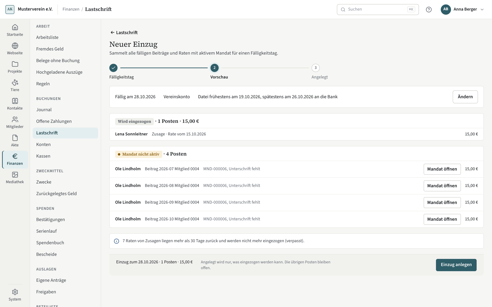

# Einzug

Ein Einzug sammelt alle fälligen Beiträge und Raten mit aktivem Mandat für einen Fälligkeitstag. Kompass erzeugt die
Datei für die Bank; hochladen und freigeben tun Sie im Online-Banking. Die Übersicht steht unter
**Finanzen → Lastschrift**, mit den Reitern Einzüge, Mandate und Zusagen.

## Neuer Einzug

1. **Fälligkeitstag**: Wählbar sind die Bankarbeitstage bis ein Jahr voraus, frühestens so viele Bankarbeitstage nach
   heute, wie die Bank für die Einreichung verlangt (siehe [Lastschrift einrichten](lastschrift-einrichten.md)). Dazu
   das Konto. Zwei Fristen gelten getrennt: Die Vorabankündigung muss rechtzeitig vor dem Fälligkeitstag beim Zahler
   sein, und die Datei reichen Sie im Fenster der Bank ein — frühestens und spätestens so viele Tage vor Fälligkeit, wie
   die Lastschriftvereinbarung sagt.
2. **Vorschau**: „Wird eingezogen“ mit Zahl und Summe, darunter je Grund, was nicht eingezogen wird — mit einem Ausweg je
   Zeile: „Mandat nicht aktiv“ führt zum Mandat, „Ankündigung zu spät“ erzeugt die fehlende Ankündigung. Eine
   Ankündigung nennt dem Zahler Betrag und **Tag der Belastung** — sie deckt genau den Einzug an diesem Tag (fällt er auf
   ein Wochenende oder einen Feiertag, am nächsten Bankarbeitstag), auch für einen schon überfälligen Beitrag, aber
   keinen späteren: Wer den Einzug verschiebt, kündigt neu an. Eine heute erzeugte Ankündigung deckt erst Einzüge nach
   ihrem Vorlauf; die Zeile nennt den frühesten Tag, und „Fälligkeit auf den … setzen“ an der Gruppe wählt ihn. Eine
   Ankündigung für einen Tag vor heute plus Vorlauf lehnt Kompass ab.
3. **Einzug anlegen** nimmt nur, was eingezogen werden kann. Die übrigen Posten bleiben offen.

## Die Seite des Einzugs

Drei Schritte, jeder mit seiner Handlung:

- **Datei erzeugen** schreibt die Datei im Format pain.008 und eine CSV für Lastschriftvorlagen. Beide bleiben am
  Schritt herunterladbar („XML für die Bank“, „CSV“). Ein Begleitzettel kommt in die Akte; er ist der Beleg der
  Gutschrift.
- **Bei der Bank einreichen**: Der Schritt nennt das Fenster der Bank, „frühestens am …, spätestens am …“. Laden Sie
  die Datei in diesem Fenster hoch und geben Sie sie frei; die Datei selbst können Sie jederzeit vorher erzeugen.
  Danach „Als eingereicht markieren“ mit dem Tag der Einreichung — ein Tag außerhalb des Fensters wird abgelehnt. Die
  Startseite erinnert an einen angelegten Einzug, sobald sein Fenster offen ist — erst an die Datei, dann an die
  Einreichung. Ändert sich ein Mandat, nachdem die Datei erzeugt ist (etwa eine neue IBAN), ist die Datei veraltet:
  „Als eingereicht markieren“ lehnt ab, bis Sie die Datei neu erzeugt haben.
- **Verfallen**: Ist das Fenster vorbei, ohne dass der Einzug eingereicht wurde, gilt er als verfallen. Seine Posten
  sind wieder frei für einen neuen Einzug und den Mahnlauf; verwerfen Sie ihn. Bucht die Bank ihn wider Erwarten doch,
  erkennt die Arbeitsliste die Gutschrift an der End-to-End-ID.
- **Gutschrift** erledigt sich über die [Arbeitsliste](arbeitsliste.md), wenn der Kontoauszug die Gutschrift bringt —
  nie von Hand. War ein Posten inzwischen anders bezahlt, nennt der Vorschlag ihn schon („schon anders bezahlt“), und
  das Festschreiben verlangt eine Bestätigung: Erstatten Sie den doppelt gezahlten Betrag oder veranlassen Sie eine
  Rückgabe.

Vor der Einreichung nimmt **Posten aus dem Einzug nehmen** (⋯ an der Zeile) einen Posten heraus; er erscheint im
nächsten Einzug. **Verwerfen …** (⋯ im Kopf) gibt alle Posten frei. Nach der Einreichung geht Verwerfen nur noch bei
der Bank: Am selben Tag setzt **Als nicht eingereicht zurücksetzen** den Einzug zurück — rufen Sie ihn dann auch bei der
Bank zurück —, später lassen Sie Posten einzeln zurückgeben. Legen Sie für denselben Tag einen zweiten Einzug an,
während der erste noch im Entwurf ist, sagt Kompass das beim Anlegen.

Raten von Zusagen, die mehr als 30 Tage vor dem Fälligkeitstag lagen und nie eingezogen wurden, zieht Kompass nicht mehr
ein; die Vorschau nennt ihre Zahl, an der Zusage stehen sie als „verpasst“. Beim Anlegen einer Zusage mit neuem Mandat
lässt Kompass Raten aus, die sich nicht mehr rechtzeitig ankündigen lassen; die Ankündigung nennt die erste Rate, die
sie decken kann.

Kommt ein Posten zurück, steht oben „Rückgabe zu klären“; siehe [Rücklastschrift](ruecklastschrift.md).
