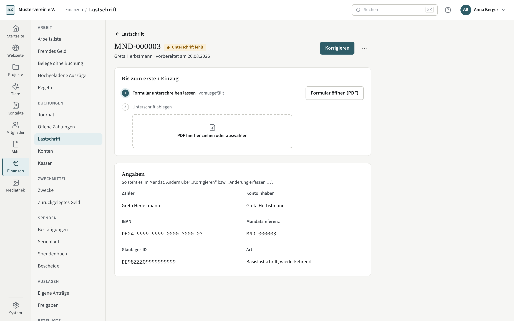

# Mandate

Ein SEPA-Mandat erlaubt dem Verein, vom Konto eines Zahlers einzuziehen. Es entsteht am Mitglied (Zahlweg Lastschrift)
oder an einer Zusage mit Lastschrift — mit IBAN und Kontoinhaber — und steht dann unter **Finanzen → Lastschrift →
Mandate**.

## Bis zum ersten Einzug

Ein neues Mandat ist vorbereitet („Unterschrift fehlt“). Die Seite des Mandats zeigt zwei Schritte:

1. **Formular unterschreiben lassen**: „Formular öffnen (PDF)“ erzeugt das vorausgefüllte Mandatsformular in der Akte.
   Drucken oder schicken Sie es dem Zahler — der Zahler ist Empfänger, das Formular lässt sich deshalb auch per E-Mail
   senden.
2. **Unterschrift ablegen**: Ziehen Sie das unterschriebene Formular auf die Ablagefläche und tragen Sie den Tag der
   Unterschrift ein. Kompass legt es in die Akte und setzt das Mandat aktiv.

Vor der Unterschrift berichtigt **Korrigieren** IBAN und Kontoinhaber am Mandat selbst. Danach ist eine neue IBAN eine
Änderung: **Änderung erfassen …** hält sie mit „gilt ab“ im Verlauf fest, und der nächste Einzug trägt den Hinweis an die
Bank.

## Verfall und Ende

Ein Mandat verfällt nach 36 Monaten ohne Einzug; die Seite nennt den Tag. **Mandat beenden …** (⋯ im Kopf) beendet es
zum Tag, mit Grund. Steckt es in einem Einzug, der noch nicht eingereicht ist, nehmen Sie den Posten dort zuerst heraus.
Ist der Einzug schon eingereicht — etwa wenn ein Zahler widerruft —, beenden Sie das Mandat zum Tag nach dem Einzug;
früher lehnt Kompass ab und nennt den frühesten Tag. Beendete und
abgelaufene Mandate stehen in der Liste gedämpft.

Unter den Angaben stehen die Änderungen, die Einzüge und die Rückgaben des Mandats.
