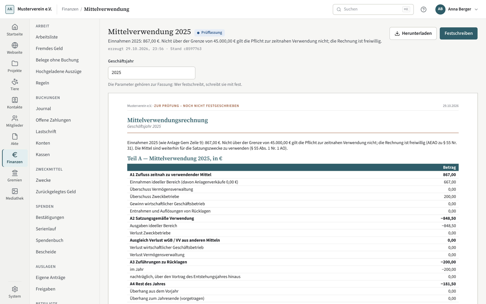

# Mittelverwendung

Die Mittelverwendungsrechnung zeigt, ob der Verein seine Mittel binnen zwei
Jahren nach dem Zufluss für die Satzungszwecke verwendet hat. Über 100.000 €
Einnahmen im Jahr ist die zeitnahe Verwendung geboten und die Rechnung ihr
Nachweis; darunter ist sie freiwillig.

## Wann die zeitnahe Verwendung geboten ist

Gemeinnützige Mittel sind bis zum Ende des übernächsten Jahres nach dem Zufluss
zu verwenden (§ 55 Abs. 1 Nr. 5 AO). Das gilt nur, wenn die Einnahmen eines
Jahres **über** der Grenze liegen — 45.000 € ab 2021, 100.000 € ab 2026. Genau
an der Grenze gilt es nicht („nicht mehr als“). Für Jahre vor 2021 gibt es keine
Freigrenze: Dort gilt das Gebot immer, mit Schritt 13 und Frist. Als Einnahmen
zählt dieselbe Zahl wie in Zeile 9 der Anlage Gem (AEAO zu § 55 Nr. 30); der
Kopf des Berichts nennt sie, die Grenze und ob die zeitnahe Verwendung geboten
ist. Gesetzlich geboten ist die Verwendung selbst; die Rechnung ist der übliche
Nachweis dafür (AEAO zu § 55 Nr. 29).

Ein Jahr nicht über der Grenze erledigt alle Vorträge: Wird es abgeschlossen,
entfallen zu seinem Ende die offenen Rückstände und ihre Fristen, auch die aus
früheren Jahren über der Grenze (AEAO zu § 55 Nr. 31). Das nächste Jahr über
der Grenze beginnt mit Vortrag 0. Solange das Jahr offen ist, stehen die
Rückstände weiter mit Frist da, mit dem Satz „Entfällt, wenn das Jahr … mit
Einnahmen nicht über der Grenze abgeschlossen wird.“ Die Mittel sind trotzdem
für die Satzungszwecke zu verwenden (§ 55 Abs. 1 Nr. 1 AO).

## Den Bericht lesen

Der Bericht steht unter Finanzen → Rechenschaft → Berichte (Gruppe Finanzamt)
im Querformat. Es zählen festgeschriebene Buchungen; ein Entwurf ändert die
Rechnung nicht. Festschreiben geht im abgeschlossenen Jahr, ohne Freigabe der
Kassenprüfung, aber wie bei allen Berichten erst, wenn je Bankkonto der Auszug
zum Stichtag liegt oder sein Fehlen begründet ist (siehe
[Berichte](berichte.md)).

**Teil A — Mittelverwendung des Jahres:**

- **A1 Zufluss:** Einnahmen des ideellen Bereichs (mit Verkäufen von
  Anlagegütern, AEAO zu § 55 Nr. 29 — die zählen für die Grenze nicht, der
  Kopf nennt den Unterschied), Überschüsse aus Vermögensverwaltung,
  Zweckbetrieben und wirtschaftlichem Geschäftsbetrieb und Entnahmen oder
  Auflösungen von Rücklagen im Jahr. Zuführungen zum Vermögen (§ 62 Abs. 3 AO)
  stehen nur nachrichtlich darunter.
- **A2 Verwendung:** Ausgaben des ideellen Bereichs und ein Verlust der
  Zweckbetriebe.
- **Ausgleich Verlust wGB / VV aus anderen Mitteln:** Ein Verlust im
  wirtschaftlichen Geschäftsbetrieb oder in der Vermögensverwaltung ist keine
  Verwendung. Er steht in einer eigenen Zeile mit dem Hinweis „mögliche
  Mittelfehlverwendung (AEAO zu § 55 Nr. 4–9) — Ausnahme prüfen und begründen“,
  auch unter der Grenze.
- **A3 Zuführungen zu Rücklagen** und **A4 Rest des Jahres.**

Darunter stehen die **Vorträge je Entstehungsjahr** mit „zu verwenden bis“ und
dem Stand. Zwei Annahmen nennt der Bericht: Verbraucht werden die ältesten
Mittel zuerst, und was mehr ausgegeben wurde, als da war (Überhang), wird
vorgetragen und mit späteren Zuflüssen verrechnet.

**Teil B — Abgleich mit dem Vermögen** am Jahresende: Konten, offene Zahlungen,
Verpflichtungen, Vermögen nach § 62 Abs. 3 AO und Rücklagen; daraus „noch zu
verwenden laut Vermögen“ gegen Teil A. Sonstige Vermögensgegenstände stehen
nachrichtlich daneben. Anlagegüter, Darlehen und Wertpapiere kennt Kompass
nicht; der Bericht sagt das.

**Teil C — Rücklagenspiegel** wie der Bericht [Rücklagenspiegel](berichte.md).

## Anfangsvortrag

Kommt ein Verein mit Vorjahren zu Kompass und lag damals über der Grenze,
tragen Sie einmal je Entstehungsjahr ein, was aus jenem Jahr noch zu verwenden
war — höchstens für die zwei Jahre vor dem ersten Kompass-Jahr, je mit den
Einnahmen jenes Jahres und einem Beleg (etwa „aus 2025 noch zu verwenden:
3.000 €“). Lag ein solches Jahr nicht über der damaligen Grenze, wirkt der
Vortrag mit 0 und der Bericht sagt warum. Er steht nur im ersten Kompass-Jahr
im Bericht. Ändern lässt er sich, solange das erste Kompass-Jahr offen ist;
danach nur nach dessen Wiederöffnen. Jede Änderung steht im Protokoll.

## Rücklagen im wGB und in der Vermögensverwaltung

Neben den Rücklagen nach § 62 AO gibt es zwei Arten für Vorhaben im
wirtschaftlichen Geschäftsbetrieb und in der Vermögensverwaltung (AEAO zu § 55
Nr. 3 und 28). Sie brauchen Beschluss und Begründung (wofür im Betrieb), mindern
in Teil A den Rest, sind aber keine Rücklagen nach § 62 AO: Sie stehen nicht in
der Anlage Gem (Zeilen 50–59) und nicht im Höchstbetrag der freien Rücklage.

Eine Rücklage nach § 62 AO lässt sich bis zum Ende des übernächsten Jahres
nachträglich aus den Mitteln eines Vorjahres bilden (§ 62 Abs. 2 AO). Sie wirkt
im Jahr des Beschlusses und mindert dort den Vortrag ihres Entstehungsjahres;
eine schon festgeschriebene Rechnung bleibt, wie sie ist (siehe
[Zwecke und zurückgelegtes Geld](zwecke-und-ruecklagen.md)).

## Über der Grenze

Liegen die Einnahmen eines Jahres über der Grenze, gehört die Rechnung dazu:

- **Jahresabschluss:** Schritt 13 „Mittelverwendung festschreiben“ — erledigt,
  sobald der Bericht des Jahres festgeschrieben ist (siehe
  [Jahresabschluss](jahresabschluss.md)).
- **Prüfpaket:** Die Prüffassung der Mittelverwendungsrechnung kommt zu den
  übrigen Prüffassungen.
- **Fristen:** Je Rückstand steht unter [Fristen und Schwellen](fristen-und-schwellen.md)
  „Mittel aus … bis … verwenden“; die Frist verschwindet, sobald die Ausgabe
  festgeschrieben ist.

Unter der Grenze gibt es keinen Schritt, keinen Eintrag im Prüfpaket und keine
Frist. Offene Rückstände aus Jahren über der Grenze behalten ihre Frist, bis
ein Jahr nicht über der Grenze abgeschlossen ist; danach stehen sie einmal als
„Verwendungsfrist … entfallen“ da.

## Mit einem Agenten

Lesen geht mit `finance_report` (Bericht `fundsUse`), `finance_closing_status`
und `finance_deadlines`; den Anfangsvortrag setzt `finance_funds_use_opening_save`.
Festschreiben ist ein persönlicher Schritt wie bei allen Berichten.
