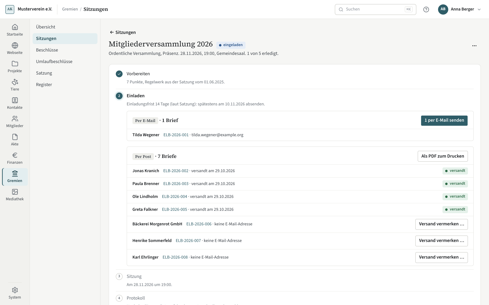

# Sitzungen

Unter **Gremien → Sitzungen** bereiten Sie Sitzungen der Mitgliederversammlung, des Vorstands und anderer Organe vor,
laden ein, laufen in der Sitzung mit und schreiben das Protokoll fest.

## Vergangene Sitzungen nachtragen

Für den Start in Kompass brauchen Sie keine alten Sitzungen: Es reichen der gültige Satzungsstand und die heutigen
Ämter, alte Protokolle bleiben als Dokumente in der Akte. Soll eine vergangene Sitzung trotzdem als Datensatz in Kompass
stehen, geht das in dieser Fassung nur über einen Agenten (Werkzeug `governance_meeting_backfill`). Bis zum Festschreiben
kann der Agent ihren Kopf und die Einladung berichtigen (`governance_meeting_backfill_correct`). Festgeschrieben wird
auch sie hier in Kompass.

## Die Liste

Die Liste zeigt alle Sitzungen, die neueste oben. Filtern lässt sie sich nach Organ, Jahr und Zustand. Eine Marke
steht nur, wenn etwas zu tun ist oder die Sitzung nicht festgeschrieben ist: „Einladung bis …“ erscheint einige Tage
vor dem letzten Tag, an dem die Einladung hinausgehen muss (der Vorlauf steht unter **Einrichtung → Gremien**),
„protokolliert“ heißt, dass Unterschrift und Festschreiben noch fehlen.

## Sitzung anlegen

**Sitzung anlegen** fragt Organ, Art, Datum, Uhrzeit, Form (Präsenz, hybrid, online), Ort und bei hybrid oder online
den Zugang und den Hinweis, wie die Mitglieder ihre Rechte elektronisch ausüben. Die vorgesehene Leitung und
Protokollführung wählen Sie aus den Kontakten. Das Organ steht nach dem Anlegen fest.

## Die fünf Schritte

Eine Sitzung ist ein Vorgang mit fünf Schritten: **Vorbereiten**, **Einladen**, **Sitzung**, **Protokoll** und
**Festschreiben**. Der Kopf sagt, wie viele davon erledigt sind. Unter **⋯** ändern Sie die Angaben, sagen ab oder
löschen eine geplante Sitzung, die noch keine Einladung hat.

### Tagesordnung

**Tagesordnung vorschlagen** legt die üblichen Punkte der Art an; alles bleibt änderbar. **Punkt anlegen** fragt
Titel, Art und den Antrag, der in der Einladung und im Mitlauf über dem Ergebnis steht. Je nach Art kommen das Amt
(Wahl), das Geschäftsjahr (Entlastung, Kassenbericht) oder der Satzungsstand dazu; die Mehrheit aus dem Regelwerk steht
im Dialog. Die Reihenfolge ändern Sie mit den Pfeilen, am Telefon über **⋯**. Ist die Einladung schon unterwegs, sagt
ein Hinweis, dass Sie Änderungen den Mitgliedern nachreichen müssen — mit **Nachtrag ausstellen …**.

### Anträge

Anträge zur Tagesordnung erfassen Sie mit **Antrag erfassen …**. Ein Antrag, der nach der Antragsfrist eingeht, trägt
die Marke „nach Frist“ — er wird nicht abgewiesen: In der Sitzung stimmt die Versammlung über die Aufnahme ab.
**Aufnehmen …** macht einen Antrag vorher zum Punkt.

### Einladen

Die Mitgliederversammlung lädt jedes Mitglied mit einem eigenen Brief ein, damit Zugang und Versandweg je Person
nachweisbar sind. **Einladung vorbereiten** öffnet den Serienlauf: Vorschau mit Weg und Stimmrecht je Mitglied, dann
**Einladungen ausstellen** und der Versand — per E-Mail an alle, die zugestimmt haben, die übrigen als PDF zum Drucken
mit **Versand vermerken …**. Ein Agent stellt nur aus, wenn der Verein es unter
[Verwaltung → Agenten](../einstellungen/agenten.md) erlaubt hat. Danach steht im Schritt, ob
die Frist gewahrt ist. Nachtrag und Absage laufen auf dieselbe Weise.

Beim Vorstand gibt es keinen Serienlauf: **Einladung ausstellen** und **Per E-Mail senden**, oder **Einladung vermerken
…**, wenn die Einladung anders hinausging, etwa per Messenger.

### Sitzung

Am Sitzungstag beginnt die Protokollführung die Sitzung mit **Sitzung beginnen**; Kompass legt die Anwesenheitsliste
an und öffnet den Mitlauf. Wie er funktioniert, steht unter [Mitlauf](mitlauf.md).

### Protokoll

Nach dem Mitlauf steht der **Entwurf** als PDF bereit. Drucken Sie ihn, lassen Sie ihn unterschreiben und legen Sie den
Scan ab; Kompass legt ihn in die Akte. Für die Mitgliederversammlung stellen Sie hier die **Anwesenheitsliste** aus und,
wenn ein vertretungsberechtigtes Amt gewählt wurde, die **Angaben für die Registeranmeldung** — sie stehen nicht im
Protokoll selbst. Offene Punkte aus dem Mitlauf stehen darunter: eine fehlende Feststellung oder Begründung (dafür
**Mitlauf wieder öffnen …**, solange keine Fassung abgelegt ist) und Gewählte, die noch nicht angenommen haben
(**Annahme erfassen …**).

Ist die Fassung abgelegt, gilt das Papier: Eine Annahme lässt sich dann nur noch für jemanden erfassen, der sich noch
nicht erklärt hat; eine schon gespeicherte Erklärung ändert nur eine Berichtigung. Wurde die falsche Datei abgelegt,
ersetzen Sie sie vor dem Festschreiben über ⋯ neben der Nummer mit **Fassung ersetzen …** und einem Grund. Die alte
Fassung wird in der Akte storniert, nicht gelöscht; danach können Sie den Mitlauf wieder öffnen oder die richtige
Fassung ablegen.

### Festschreiben

Der letzte Schritt nennt, was dabei entsteht: die Nummern der Beschlüsse, Amtszeiten, Satzungsstände, fällige
Registeranmeldungen, Wiedervorlagen für Aufträge und Hinweise, was bei den Mitgliedern zu erledigen ist. **Festschreiben …** fragt einmal nach; danach geht eine Änderung
nur noch über eine Berichtigung. Ein Agent schreibt nur fest, wenn der Verein es unter
[Verwaltung → Agenten](../einstellungen/agenten.md) erlaubt hat. Festschreiben lässt sich eine Sitzung frühestens an ihrem Tag.

## Abschrift auf Verlangen

Mitglieder haben ein Recht auf eine Abschrift des Protokolls. Laden Sie die unterschriebene Fassung in der Akte
herunter; sie hängt an der Sitzung unter **Dokumente**.
