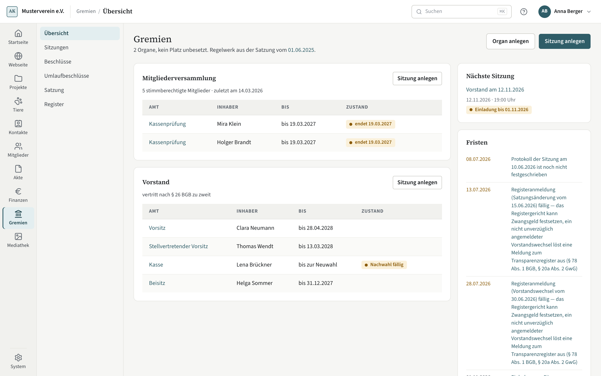

# Übersicht der Gremien

Die Übersicht zeigt je Organ seine Ämter mit einer Zeile je Platz: wer das Amt hat und bis wann. Rechts stehen die
nächste Sitzung und die Fristen der Gremien.

## Organe und Plätze

Jedes Organ steht als Karte. Mitgliederversammlung und Vorstand gibt es in jedem Verein; weitere Organe (Beirat,
Ausschuss) legen Sie über **Organ anlegen** an. Eine Marke steht nur bei Anstehendem: **endet …**, wenn eine Amtszeit
in den nächsten sechs Monaten ausläuft, **unbesetzt** bei einem freien Platz und **unvereinbar**, wenn eine Person zwei
Ämter hat, die nicht zusammengehören (etwa Kasse und Kassenprüfung).

## Besetzen und Amtszeit beenden

An einem freien Platz öffnet **Besetzen …** den Dialog: Person, Herkunft (ersatzweise bestellt, berufen, nachgetragen,
gerichtlich bestellt), Beginn und ein Nachweis aus der Akte. Gewählt wird nur in einer Sitzung — diese Einträge entstehen
beim Festschreiben. Kompass weist auf Ersatzbestellungen ohne Satzungsgrundlage und auf unvereinbare Ämter hin, sperrt
aber nicht.

Am Organ beendet **Amtszeit beenden …** eine laufende Amtszeit. Bei einem Rücktritt zählt der Tag, an dem die
Niederlegung einem anderen Vorstandsmitglied zugegangen ist (§ 26 Abs. 2 S. 2 BGB).

## Ämter

Am Organ legen Sie Ämter an: Zahl der Plätze, ob das Amt den Verein nach § 26 BGB vertritt, die Amtszeit in Monaten
(leer: unbefristet), ob es bis zur Neuwahl im Amt bleibt, die Funktion (sie bestimmt die Kontaktrolle) und welche Ämter
dieselbe Person nicht zugleich haben soll. Die Vertretungsregel des Vorstands steht im Regelwerk der Satzung. Ein Amt,
das den Verein vertritt, setzt an der Rolle Vorstandsmitglied „vertritt nach § 26 BGB“; ändern Sie das am Amt, folgen
die laufenden Amtszeiten sofort, beendete bleiben, wie sie waren.

## Was Gremien für andere Bereiche führt

Solange Gremien eingeschaltet ist, kommt aus den Ämtern und festgeschriebenen Sitzungen:

- **Kontaktrollen** Vorstandsmitglied, Schatzmeister und Kassenprüfung — von Hand nicht mehr änderbar, soweit eine
  Amtszeit sie trägt; ältere Zeilen von vor Gremien lassen sich am Kontakt weiter beenden.
- **Schritt 11 des Jahresabschlusses** (Finanzen): Entlastung und Genehmigung der Jahresrechnung aus der jüngsten
  festgeschriebenen Mitgliederversammlung zum Geschäftsjahr; je Person zählt der jüngste Entlastungsbeschluss — eine erteilte Entlastung bleibt aber
  stehen; verweigert eine spätere Versammlung sie, weist Schritt 11 darauf hin. Eine nur
  beendete Sitzung liefert noch nichts. Schalten Sie Gremien aus, gilt Schritt 11 wieder von Hand; die Finanzen weisen
  dort darauf hin, aus welcher Sitzung das Ergebnis bisher kam.
- **Vergütung des Vorstands** (Einrichtung → Finanzen → Steuerliches): ein angenommener, festgeschriebener Beschluss
  über die Vergütung setzt den Punkt.

Handlungen der Finanzen bleiben dort: Prüfer eintragen mit Art und Zugang, Rücklagen und Beitragsordnung pflegen
(beide können auf einen Beschluss verweisen), die Angaben der Steuererklärung speichern (das Satzungsdatum ist nur
vorgeschlagen). Gremien schreibt nie in Schritt 11 und nie in die Liste der Prüfer.

Die Übersicht warnt, wenn Gremien und die Finanzen uneins sind, ob die Mitgliederversammlung die Jahresrechnung
genehmigt: eine Mehrheit für „Jahresrechnung“ im Regelwerk der Versammlung, oder ein festgeschriebener, angenommener
Beschluss der Versammlung, der die Jahresrechnung genehmigt — gegen die Einstellung unter Einrichtung → Finanzen →
Berichte. Ändern Sie die Einstellung dort; Gremien ändert sie nicht.

## Fristen

Die Fristen nennen, was als Nächstes zu tun ist — Einladungen, Anträge, auslaufende Amtszeiten, offene Protokolle,
Registeranmeldungen, Umläufe. Jede Frist führt zu der Seite, auf der man sie erledigt. Verlangt die Satzung eine
ordentliche Mitgliederversammlung im Jahr, warnt die Startseite ab einem Stichtag (Einrichtung → Gremien), solange
keine angesetzt ist.
