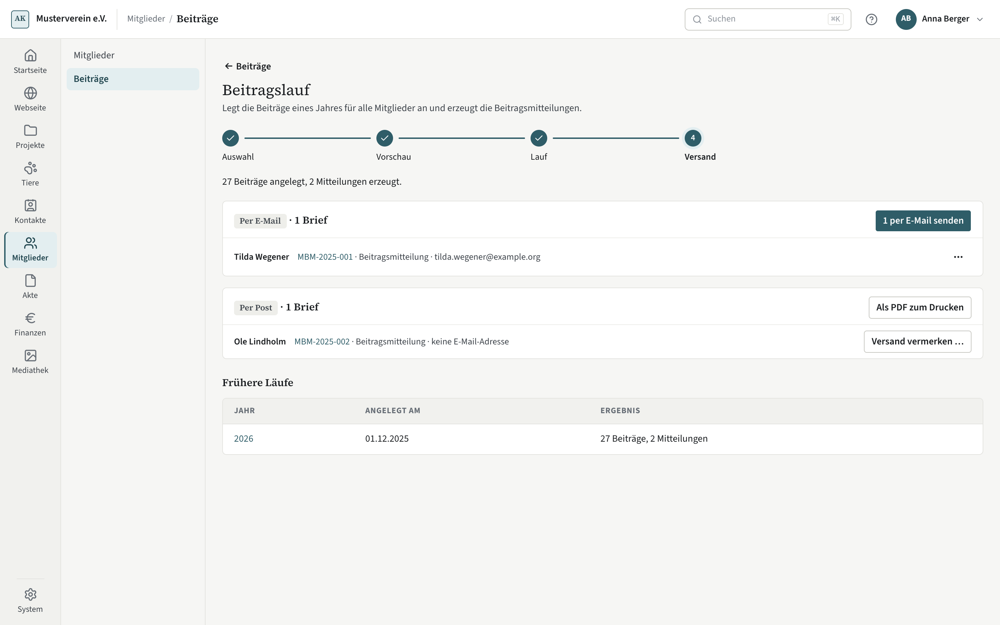

# Beiträge und Mahnungen

Jeder Beitrag ist eine offene Zahlung der Finanzen mit dem Verwendungszweck „Beitrag {Jahr} Mitglied {Nummer}“. Gibt
ein Mitglied ihn bei der Überweisung an, ordnet die Arbeitsliste die Zahlung sicher zu.

## Die Beiträge eines Jahres

Unter **Mitglieder → Beiträge** steht das Jahr vorn in der Filterleiste. Darunter die Summen Soll, Bezahlt, Offen und
„Davon gemahnt“, dann eine Zeile je Beitrag — bei monatlichem oder halbjährlichem Rhythmus eine Zeile je Zeitraum.
Über ⋯ einer offenen Zeile **stunden** Sie einen Beitrag (neue Fälligkeit, bis dahin keine Mahnung) oder **erlassen**
den offenen Rest. Beides geht nur hier in Kompass, nicht über einen Agenten.

Hat ein Jahr noch keine Beiträge, nennt die Seite, was die Beitragsordnung ergäbe, und führt zum Beitragslauf.

## Beitragslauf

**Beiträge anlegen** öffnet den Beitragslauf: Jahr wählen, Vorschau ansehen, anlegen, versenden. Die Vorschau zeigt,
was angelegt wird, was schon da ist und wer beitragsfrei ist. Beitragsmitteilungen bekommen Mitglieder mit
Lastschrift immer — die Mitteilung ist zugleich die Ankündigung des Einzugs —, auf Wunsch alle. Sie nennt je Beitrag
den Tag der Belastung: die Fälligkeit, frühestens aber Briefdatum plus Vorabankündigung, auf den nächsten
Bankarbeitstag (ein Beitrag fällig am 1. Januar wird am ersten Bankarbeitstag des Jahres eingezogen). Legen Sie den
Einzug auf genau diesen Tag; für einen anderen Tag braucht es eine neue Ankündigung. Bezahlte Beiträge stehen als „bezahlt“ in der
Mitteilung, Überweisungs-Beiträge mit ihrer Frist (für schon fällige: Briefdatum plus Zahlungsziel). Zahlt jemand
anderes per Lastschrift — etwa die Eltern —, nennt die Mitteilung das Konto, und der Kontoinhaber bekommt die
Ankündigung als eigenen Brief. Diese Ankündigung nennt je Einzug Tag und Verwendungszweck und steht im Versand
desselben Laufs, nach dem Zustellweg des Kontoinhabers.

Die Ankündigung ist ein Dokument der Finanzen. Wer den Lauf ohne Finanzrechte startet, bekommt sie nicht erzeugt;
das Ergebnis des Laufs nennt, für wie viele Mitglieder sie fehlt, und die Einzugsvorschau der Finanzen hält diese
Beiträge zurück, bis eine Ankündigung vorliegt. Wer ohne Finanzrechte versendet, sieht sie nur als Zahl; die übrigen
Briefe gehen normal hinaus.

Wechselt ein Mitglied von Lastschrift auf Überweisung, nennt die Vorschau beim Speichern die Beiträge, die ein Brief
schon als Einzug angekündigt hat. Das Mitglied verlässt sich auf den Einzug: Stellen Sie danach eine neue
Beitragsmitteilung mit den Überweisungsdaten aus.

Der Lauf arbeitet in kleinen Schritten. Verlassen Sie die Seite, geht er beim nächsten Besuch weiter; seinen Stand
finden Sie unter „Frühere Läufe“.

## Mahnlauf

**Mahnlauf** im Kopf der Beiträge-Seite erzeugt je Mitglied einen Brief über alle reifen Beiträge. Die Stufen und ihre
Fristen stellen Sie in den Einstellungen ein. Die Vorschau gruppiert:

- **Zahlung könnte passen**: Ein noch nicht zugeordneter Eingang der letzten 30 Tage passt nach Betrag, IBAN oder
  Name. Dieses Mitglied wird nicht gemahnt, bis der Umsatz in der Arbeitsliste zugeordnet ist; der Lauf geht für die
  übrigen weiter.
- je Stufe die Briefe,
- **Übersprungen** mit Grund: letzte Stufe erreicht, vorige Stufe nicht als versandt vermerkt, gestundet,
  Lastschrift ohne Rückgabe oder eine Zahlung, die als Entwurf gebucht, aber noch nicht festgeschrieben ist.

Nach einer Stundung beginnt die Mahnstufe des Beitrags neu. Die Startseite zählt unter „Beitragsrückstände“ weder
gestundete Beiträge vor ihrer neuen Fälligkeit noch Beiträge, die in einem bei der Bank eingereichten Einzug stecken.

Eine Stufe gilt erst mit dem Versandvermerk als erreicht; die Frist der nächsten Stufe zählt ab dort.

Der Stichtag des Laufs ist höchstens heute. Die Vorschau dürfen Sie auch für einen späteren Tag ansehen, etwa um
zu planen; gestartet wird der Lauf erst an diesem Tag.

## Versand

Der letzte Schritt beider Läufe teilt die Briefe in zwei Gruppen. **Per E-Mail** gehen die Briefe an Kontakte mit
E-Mail-Adresse; der Versandvermerk entsteht, sobald der Mailserver die Mail angenommen hat. Rückläufer, die später
als Mail kommen, sieht Kompass nicht. Wird eine Mail nicht zugestellt, senden Sie sie erneut oder schicken den Brief
per Post. **Per Post** laden Sie die Briefe als ein PDF zum Drucken und vermerken den Versand je Brief. Fertig ist
der Lauf, wenn er alle Briefe ausgestellt hat und jeder Brief gesendet oder vermerkt ist. Ein Brief, der schon als per Post versandt vermerkt ist, geht nicht zusätzlich per
Mail.

Wollen Sie einen Brief der Mail-Gruppe lieber drucken, wählen Sie im Menü ⋯ der Zeile **Per Post schicken**: Er
wandert mit dem Grund „von Hand verschoben“ in die Post-Gruppe, eine wartende Mail wird zurückgezogen. Das geht,
solange die Mail wartet oder nicht zugestellt ist, nicht mehr, während sie gesendet wird oder wenn sie gesendet ist.
In der Post-Gruppe holt **Zurück zu E-Mail** im Menü ⋯ den Brief zurück, solange er keinen Versandvermerk trägt;
gesendet wird er dann mit „… per E-Mail senden“. Ist der E-Mail-Versand aus, gibt es keine Mail-Gruppe: Alle Briefe
stehen in der Post-Gruppe mit dem Grund „E-Mail-Versand aus“.

## Briefe stornieren

Ein Mitglieder-Brief, der noch keinen Versandvermerk trägt, lässt sich in der Akte stornieren wie jedes andere
Dokument — etwa eine Beitragsmitteilung mit falschem Betrag. Eine stornierte Mahnung zählt nicht als Stufe, eine
stornierte Zahlungsaufforderung hält einen Beitrag nicht mehr auf Überweisung, und ein stornierter Brief eines Laufs
geht nicht hinaus; der Versandschritt nennt ihn. Ist der Brief schon versandt, schreiben Sie eine Berichtigung als
neuen Brief.
